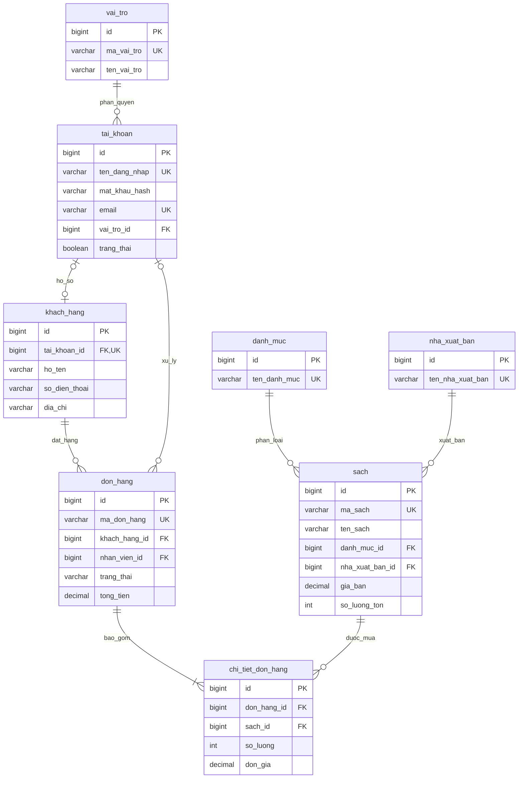

# Sơ đồ quan hệ cơ sở dữ liệu

Mở file bằng trình xem Markdown hỗ trợ Mermaid để hiển thị sơ đồ.

Sơ đồ hiển thị các thuộc tính cốt lõi; SQL chứa đầy đủ trường dữ liệu.
Đơn hàng nghiệp vụ phải có ít nhất một chi tiết; service sẽ kiểm tra quy tắc này.
